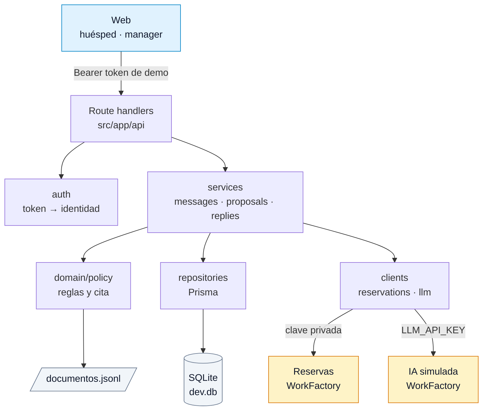
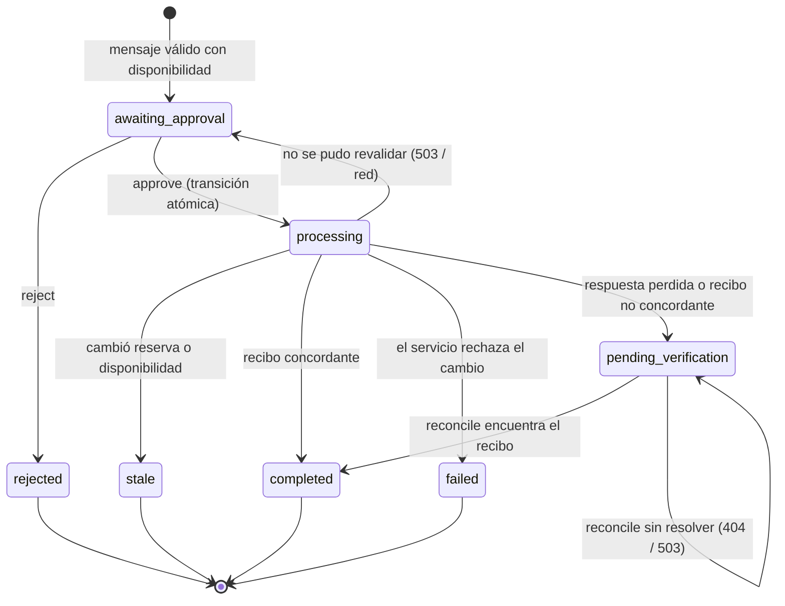

# Una salida más tarde

Aplicación para gestionar solicitudes de late checkout en un hotel.

El huésped envía un mensaje. El servidor interpreta la petición, comprueba la reserva, las políticas del hotel y la disponibilidad, y con todo ello, crea una propuesta. Un manager la aprueba o rechaza. Antes de aplicar el cambio, el servidor vuelve a validar los datos y exige un recibo concordante.

## Índice

- [Estado actual](#estado-actual)
- [Stack](#stack)
- [Puesta en marcha](#puesta-en-marcha)
  - [Requisitos](#requisitos)
  - [Variables de entorno](#variables-de-entorno)
  - [Instalación](#instalación)
- [Comandos](#comandos)
- [API](#api)
- [Arquitectura](#arquitectura)
- [Estados](#estados)
- [Servicios externos](#servicios-externos)
- [Seguridad e integridad](#seguridad-e-integridad)
- [Políticas del hotel](#políticas-del-hotel)
- [Persistencia](#persistencia)
- [Trazas](#trazas)
- [Tests](#tests)
- [Reinicio del entorno](#reinicio-del-entorno)
- [Limitaciones conocidas](#limitaciones-conocidas)
- [Estructura principal](#estructura-principal)
- [Decisiones de diseño](#decisiones-de-diseño)

## Estado actual

Implementado:

- Autenticación mediante tokens de demo.
- Control de rol, hotel y reserva.
- Cliente del servicio remoto de reservas.
- Cliente de la IA simulada.
- Validación estricta con Zod.
- Selección de políticas y extracción de citas.
- Procesamiento de mensajes.
- Deduplicación de eventos.
- Creación, aprobación y rechazo de propuestas.
- Persistencia local con Prisma y SQLite.
- Trazas de las operaciones principales.
- Tests unitarios sin red.
- Script para restablecer la base de datos y los servicios remotos.

Pendientes:

- Interfaz para huéspedes y managers.
- Contexto entre mensajes de una misma conversación.
- `GET /api/conversations/{id}`.
- `POST /api/proposals/{id}/reconcile`.
- Trazas de aprobación, rechazo y reconciliación.
- Tests automatizados de los casos públicos.

## Stack

- **Next.js 16** (App Router, route handlers en `src/app/api`) + React 19 + Tailwind 4.
- **TypeScript** estricto y **Zod 4** para validar todo lo que entra: peticiones, `.env`, respuestas de los servicios remotos, salida de la IA y ficheros del kit.
- **Prisma 7 + SQLite** (`better-sqlite3`) como base de datos local.
- **Vitest** para tests.
- **pnpm** como gestor de paquetes.

## Puesta en marcha

### Requisitos

- Node.js 24.
- pnpm 11.
- Credenciales y configuración del kit de la prueba.

### Variables de entorno

Crear el fichero `.env` a partir de la plantilla:

```bash
cp .env.example .env
```

Después, rellenarlo con los valores del kit. Son las 13 variables del **kit** más `DATABASE_URL`, que ya viene con un valor por defecto:

| Variable                       | Uso                                          |
| ------------------------------ | -------------------------------------------- |
| `DATABASE_URL`                 | Base de datos SQLite local                   |
| `RESERVATIONS_BASE_URL`        | URL del servicio de reservas                 |
| `RESERVATIONS_SCENARIO`        | Escenario del servicio de reservas           |
| `RESERVATIONS_GUEST_A1_TOKEN`  | Credencial de la sesión `guest-a1`           |
| `RESERVATIONS_GUEST_A2_TOKEN`  | Credencial de la sesión `guest-a2`           |
| `RESERVATIONS_GUEST_B1_TOKEN`  | Credencial de la sesión `guest-b1`           |
| `RESERVATIONS_MANAGER_A_TOKEN` | Credencial del manager del hotel A           |
| `RESERVATIONS_MANAGER_B_TOKEN` | Credencial del manager del hotel B           |
| `RESERVATIONS_TESTER_TOKEN`    | Controles de prueba del servicio de reservas |
| `LLM_BASE_URL`                 | URL de la IA simulada                        |
| `LLM_MODEL`                    | Modelo utilizado                             |
| `LLM_SCENARIO`                 | Escenario de la IA simulada                  |
| `LLM_API_KEY`                  | Credencial de la IA                          |
| `LLM_TESTER_TOKEN`             | Controles de prueba de la IA                 |

### Instalación

1. Instalar dependencias:

```bash
pnpm install
```

> Al instalar, el script `postinstall` ejecuta `prisma generate`, que genera el cliente en `src/generated/prisma`.

2. Crear la base de datos:

```bash
pnpm db:migrate
```

3. Iniciar la aplicación:

```bash
pnpm dev
```

La aplicación queda disponible en <http://localhost:3000>

## Comandos

| Comando             | Descripción                                  |
| ------------------- | -------------------------------------------- |
| `pnpm dev`          | Inicia el servidor de desarrollo             |
| `pnpm build`        | Genera la build de producción                |
| `pnpm start`        | Arranca la build de producción               |
| `pnpm test`         | Ejecuta los tests                            |
| `pnpm test:watch`   | Ejecuta los tests en modo observación        |
| `pnpm type-check`   | Comprueba los tipos de TypeScript            |
| `pnpm lint`         | Ejecuta ESLint                               |
| `pnpm lint:fix`     | Ejecuta ESLint y corrige lo que pueda        |
| `pnpm format:check` | Comprueba el formato                         |
| `pnpm format:fix`   | Aplica el formato                            |
| `pnpm db:migrate`   | Ejecuta las migraciones de BD                |
| `pnpm db:reset`     | Reinicia solo la base de datos local         |
| `pnpm db:studio`    | Abre Prisma Studio sobre `dev.db`            |
| `pnpm env:reset`    | Reinicia la BD local y los servicios remotos |

## API

Implementa el contrato `contratos/app-api.md` del kit. Autenticación con `Authorization: Bearer <token>` según `data/identidades.json`; el servidor resuelve rol, hotel y reserva.

| Método | Ruta                            | Rol                          | Estado       |
| ------ | ------------------------------- | ---------------------------- | ------------ |
| `POST` | `/api/messages`                 | Huésped                      | Implementado |
| `GET`  | `/api/conversations/{id}`       | Huésped o manager autorizado | Pendiente    |
| `GET`  | `/api/proposals`                | Manager                      | Implementado |
| `POST` | `/api/proposals/{id}/approve`   | Manager                      | Implementado |
| `POST` | `/api/proposals/{id}/reject`    | Manager                      | Implementado |
| `POST` | `/api/proposals/{id}/reconcile` | Manager                      | Pendiente    |

Los errores siguen este formato:

```json
{
  "error": {
    "code": "error_code",
    "message": "Descripción del error"
  }
}
```

Códigos principales:

- `401`: token ausente o inválido.
- `403`: rol no autorizado.
- `404`: recurso inexistente o ajeno.
- `409`: conflicto o duplicado incompatible.
- `422`: cuerpo inválido.
- `500`: error interno genérico.

### Ejemplo

```bash
curl -X POST http://localhost:3000/api/messages \
  -H 'Authorization: Bearer guest-a1' \
  -H 'Content-Type: application/json' \
  -d '{
    "event_id": "evt-001",
    "conversation_id": "conv-a1",
    "stay_id": "STAY-A1",
    "text": "Mañana quiero salir a las 14:00. ¿Se puede?"
  }'
```

## Arquitectura

### Componentes



En azul, el navegador (la interfaz aún está pendiente); en gris, los datos locales; en amarillo, los servicios remotos; el resto es código del servidor (`src/app/api` y `src/server`).

### Capas principales

| Capa          | Ubicación                 | Responsabilidad                                                     |
| ------------- | ------------------------- | ------------------------------------------------------------------- |
| Rutas         | `src/app/api`             | Autenticar, validar el cuerpo, llamar al servicio, traducir errores |
| Autenticación | `src/server/auth`         | Resolver token, rol, hotel y reserva                                |
| Servicios     | `src/server/services`     | Orquestar los casos de uso                                          |
| Dominio       | `src/server/domain`       | Aplicar reglas y seleccionar políticas                              |
| Repositorios  | `src/server/repositories` | Persistir datos con Prisma                                          |
| Clientes      | `src/server/clients`      | Comunicarse con los servicios remotos                               |
| Esquemas      | `src/server/schemas`      | Validar datos con Zod                                               |

## Estados

### Mensajes

| Estado              | Cuando                                                   |
| ------------------- | -------------------------------------------------------- |
| `needs_input`       | Falta la hora                                            |
| `information`       | La hora solicitada no requiere ningún cambio             |
| `awaiting_approval` | Existe una propuesta pendiente de aprobación             |
| `declined`          | La petición no cumple las reglas o no hay disponibilidad |
| `handoff`           | La IA, la reserva o la política no se pudieron validar   |

### Propuestas

| Estado                 | Cuando                                      |
| ---------------------- | ------------------------------------------- |
| `awaiting_approval`    | Pendiente de decisión del manager           |
| `processing`           | Se está procesando la aprobación            |
| `completed`            | Cambio confirmado mediante recibo válido    |
| `rejected`             | Rechazada por el manager                    |
| `stale`                | La propuesta quedó obsoleta                 |
| `failed`               | El servicio rechazó el cambio               |
| `pending_verification` | Resultado incierto; requiere reconciliación |



En la interfaz web (pendiente), los estados se agruparán así, según el enunciado:

| Etiqueta                | Estado                               |
| ----------------------- | ------------------------------------ |
| Pendiente de aprobación | `awaiting_approval`                  |
| Cambio sin comprobar    | `processing`, `pending_verification` |
| Completado              | `completed`                          |
| Rechazado               | `rejected`                           |
| Debe revisarse          | `stale`, `failed`                    |

## Servicios externos

Los servicios remotos de WorkFactory se llaman exclusivamente desde el servidor, que envía siempre `User-Agent: WorkFactory-Technical-Test/1.0` y `X-Test-Scenario` con el valor de `RESERVATIONS_SCENARIO` o `LLM_SCENARIO`. El escenario lo fija el servidor; nunca lo elige el huésped ni la IA.

### Servicio de reservas

Se utilizan las siguientes operaciones:

- `GET /stays/{id}`
- `POST /availability/check`
- `POST /changes`
- `GET /operations/{key}` (cliente listo; lo usará la reconciliación, aún pendiente)

### IA simulada

Se utiliza `POST /chat/completions`. La salida se valida con un esquema estricto con los campos `intent`, `requested_time` y `language`.

## Seguridad e integridad

- El rol, hotel y reserva se obtienen del token.
- Los datos enviados por el huésped no pueden cambiar sus permisos.
- Los huéspedes solo pueden acceder a sus propias conversaciones.
- Los managers solo pueden consultar propuestas de su hotel.
- Las credenciales de cada sesión se mantienen separadas.
- Los campos desconocidos se rechazan.
- Los documentos no confiables no pueden fijar reglas del hotel.
- Una misma propuesta no puede ejecutar dos cambios simultáneos.
- La `operation_key` se conserva durante todo el ciclo de la propuesta.
- Una respuesta perdida nunca se marca automáticamente como éxito.
- Un recibo no concordante nunca se considera confirmación válida.
- Las operaciones inciertas quedan en `pending_verification`.

## Políticas del hotel

Las políticas se cargan desde los documentos del kit.

Solo se consideran válidos los documentos que cumplen todos estos criterios:

- Estado `active`.
- Autoridad `approved_policy`.
- Audiencia `guest`.
- Misma organización.
- Mismo hotel.

La versión activa más alta tiene prioridad.

Si existen documentos de la misma versión con reglas contradictorias, la petición termina en `handoff`.

La cita incluida en la propuesta procede del documento utilizado y no del texto generado por la IA.

## Persistencia

Base de datos SQLite local (`dev.db`) gestionada con Prisma. Solo guarda el estado que crea la aplicación, en cuatro tablas:

| Tabla          | Contenido                                                                      |
| -------------- | ------------------------------------------------------------------------------ |
| `Conversation` | Conversación, con su hotel, reserva y propietario                              |
| `Message`      | Evento del huésped y respuesta calculada; `(conversationId, eventId)` es único |
| `Proposal`     | Datos congelados de la propuesta, estado, `operationKey`, aprobación y recibo  |
| `Trace`        | Pasos registrados al procesar cada mensaje                                     |

Las reservas, los documentos y las identidades no se copian a la base de datos. El detalle está en [`DECISIONS.md`](DECISIONS.md).

## Trazas

Cada mensaje registra en `Trace` los pasos de su procesamiento. El `trace_id` que devuelve la API es el `id` del mensaje.

| Paso                              | Qué registra                               |
| --------------------------------- | ------------------------------------------ |
| `llm.interpret`                   | Interpretación de la IA y tokens simulados |
| `reservations.get_stay`           | Lectura de la reserva                      |
| `policy.select`                   | Política seleccionada                      |
| `reservations.check_availability` | Consulta de disponibilidad y motivo        |

Cada traza guarda si el paso tuvo éxito, el error, la duración y, cuando existe, el identificador de la petición remota. Las trazas de aprobación, rechazo y reconciliación siguen pendientes.

## Tests

Los tests actuales son unitarios y sustituyen las llamadas de red por respuestas locales.

Cubren principalmente:

- Autenticación y roles.
- Esquemas de identidades.
- Formato de errores.
- Respuestas inválidas de la IA.
- Reintentos ante errores `503`.
- Validación de respuestas del servicio de reservas.
- Recibos concordantes y no concordantes.
- Mapeo de sesiones a credenciales.

Ejecutar:

```bash
pnpm test
```

Todavía no están automatizados:

- Los casos públicos completos.
- Los flujos de integración con base de datos.
- La reconciliación de operaciones inciertas.

## Reinicio del entorno

Para volver al estado inicial:

```bash
pnpm env:reset
```

El script `scripts/reset-environment.mts`:

1. Reinicia la base de datos local (`prisma migrate reset --force`).
2. Restablece el servicio de reservas (`POST /test/reset` con `RESERVATIONS_TESTER_TOKEN`).
3. Restablece la IA simulada (`POST /test/reset` con `LLM_TESTER_TOKEN`).

Para reiniciar solo la base de datos local, sin tocar los servicios remotos, usar `pnpm db:reset`.

## Limitaciones conocidas

- Las sesiones son tokens fijos de demo.
- No existe inicio de sesión real.
- La interfaz web aún no está implementada.
- Solo se contemplan español e inglés.
- La IA simulada reconoce un conjunto limitado de expresiones.
- Se trabaja con una fecha de salida fija.
- No se interpretan calendarios ni zonas horarias.
- Los documentos se cargan al iniciar la aplicación.
- SQLite está pensado para una única instancia local.
- La reconciliación de operaciones inciertas todavía está pendiente.

## Estructura principal

```text
src/
├── app/
│   └── api/              Route handlers
└── server/
    ├── auth/             Autenticación y sesiones
    ├── clients/          Clientes HTTP
    ├── domain/           Reglas de negocio
    ├── repositories/     Persistencia
    ├── schemas/          Validación con Zod
    └── services/         Orquestación de casos de uso

data/                     Documentos e identidades del kit
prisma/                   Esquema y migraciones
scripts/                  Reinicio del entorno
tests/                    Tests unitarios
DECISIONS.md              Decisiones de diseño
```

## Decisiones de diseño

Las decisiones principales están documentadas en [`DECISIONS.md`](DECISIONS.md).

Resumen:

- La base de datos solo guarda el estado creado por la aplicación.
- Las reservas, identidades y documentos mantienen sus fuentes de verdad externas.
- La aprobación se representa como una transición atómica de estado.
- Las propuestas congelan los datos que deben revalidarse.
- Los nombres y estados siguen el contrato de la aplicación.
